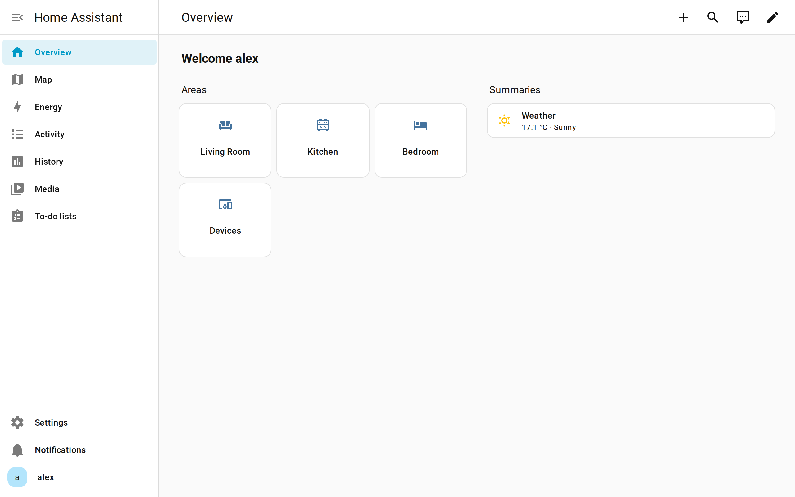
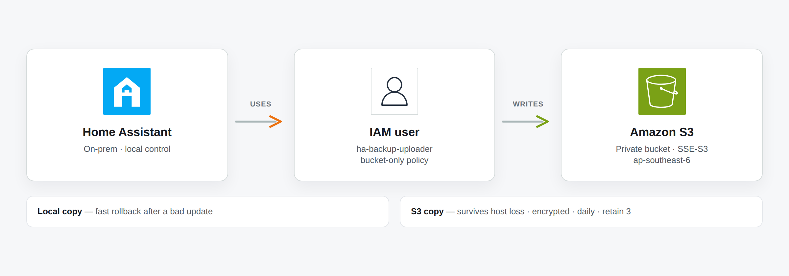
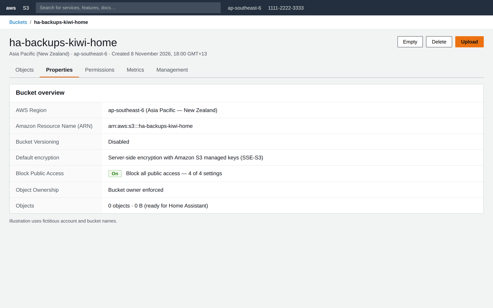
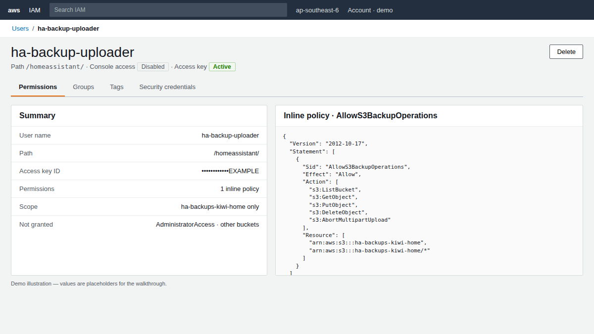
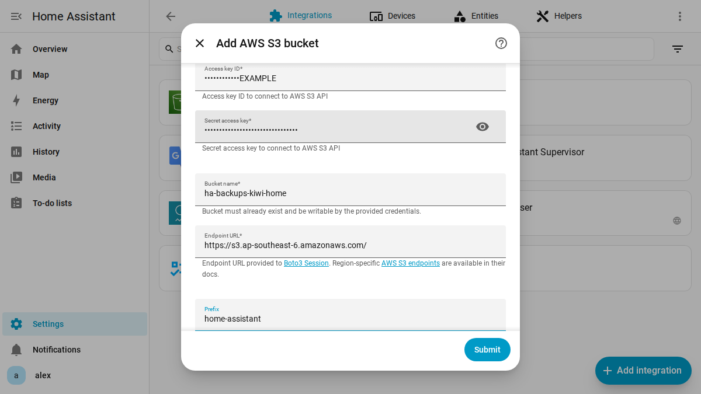
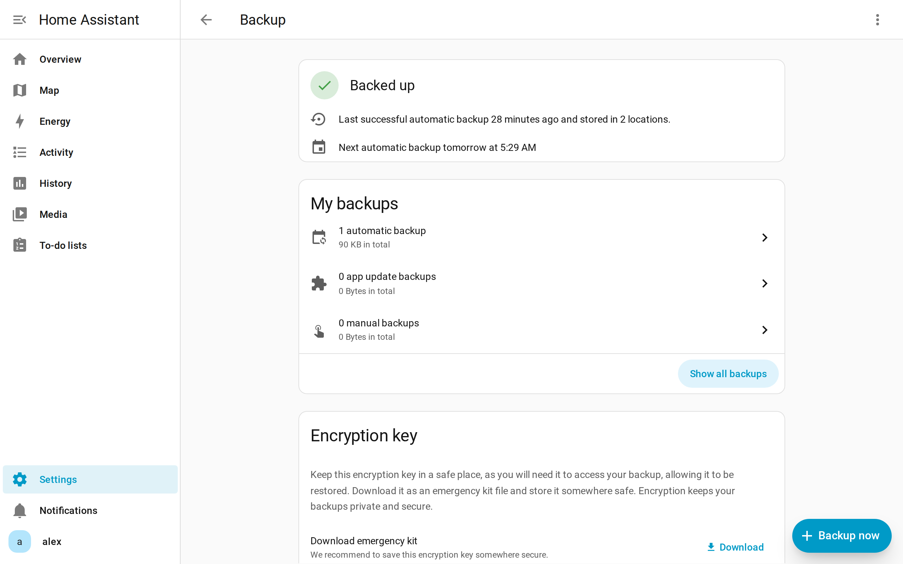
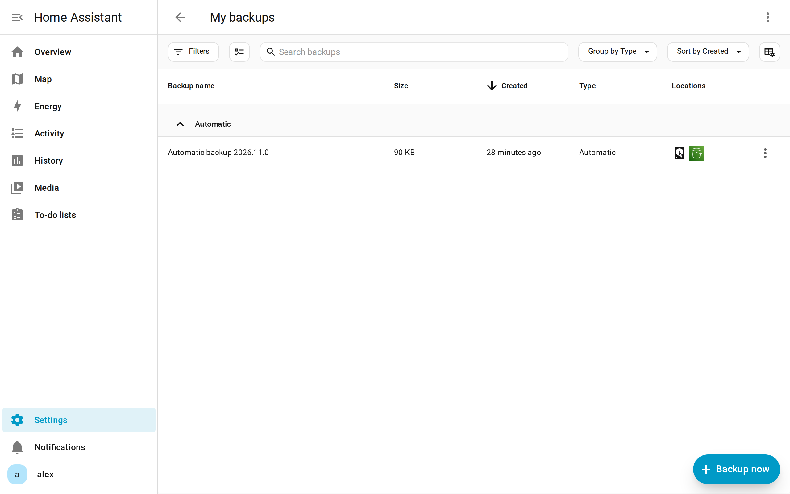

# Builder Center — Home Assistant backups on Amazon S3

Paste-ready fields for [AWS Builder Center → Create an article](https://builder.aws.com/create/content).

---

## Image upload kit

Final stills live in `captures/` next to this file. Upload in Builder Center
where placeholders appear. Prefer PNG; `03` / `04` also have `.jpg` if the
uploader rejects PNG (no `AKIA…` strings in pixels).

| # | File | Insert after… | Alt |
| - | ---- | ------------- | --- |
| 0 | `00-cover.png` | Cover / hero | HA → IAM user → S3 |
| 0b | `00-flow.png` | Opening story | HA uses IAM user, writes to S3 |
| 1 | `01-ha-home.png` | Opening story | Home Assistant overview |
| 2 | `02-s3-bucket.png` | Part 1 — bucket | Private S3 bucket properties |
| 3 | `03-iam-user.png` | Part 1 — IAM | Scoped IAM user |
| 4 | `04-ha-aws-s3.png` | Part 2 — add integration | Add AWS S3 bucket form |
| 5 | `05-ha-backups.png` | Part 2 — backups | Backup overview · 2 locations |
| 6 | `06-backup-done.png` | Done | Backup list · local + S3 |

Regenerate (optional): `scripts/capture_ha.py`, `scripts/render_cover.py`,
`scripts/render_aws_mockups.py`, `scripts/render_iam.py`,
`scripts/render_ha_s3_form.py`.

---

## Builder Center form fields

### Title

```text
Home Assistant Off-Site Backups on Amazon S3
```

### Description

```text
Rebuilding my smart home with resiliency first: a private S3 bucket, a narrowly scoped IAM user, and Home Assistant’s built-in encrypted backups as the first step toward AWS-backed home automation.
```

### Tags `(pick closest available; up to 5)`

- `amazon-s3`
- `iam`
- `backup` / `storage` (if listed)
- `iot` / `home-automation` (if listed)
- `security`

### Canonical URL `(optional)`

Omit, or link a related walkthrough / repo when you have one.

### Body

Paste everything below **Article body** into the Builder Center editor. Replace `` with uploaded images.

---

## Article body

I'm setting up Home Assistant again — this time with **resiliency** as a first-class goal.

The plan: automate the house locally, keep a clean path to **AWS** later for storage, events, and whatever else earns its place. Off-site encrypted backups are the first brick.





Local backups save you from a bad update. **S3** saves you when the whole box dies.

---

## Part 1 — Bucket and minimum IAM

In the **AWS Management Console**. Dummy values match the screenshots — swap for your own.

| Setting | Dummy value |
| ------- | ----------- |
| Region | `ap-southeast-6` (Asia Pacific — New Zealand) |
| Bucket | `ha-backups-kiwi-home` |
| IAM user | `ha-backup-uploader` |
| Path | `/homeassistant/` |

### 1. Create the bucket

**S3 → Create bucket**

- Bucket name: `ha-backups-kiwi-home`
- Region: `ap-southeast-6`
- **Block all public access** — leave all four settings on
- Default encryption: **SSE-S3** (AES-256)
- Bucket Versioning: **Disable** (so HA retention can delete old copies cleanly)

Create the bucket. Confirm **Properties** shows public access blocked and encryption on.



### 2. IAM user (programmatic only)

**IAM → Users → Create user**

- User name: `ha-backup-uploader`
- Path (optional): `/homeassistant/`
- Console access: **off** (access key only)

Attach an **inline** policy on the user (Permissions → Add permissions → Create inline policy → JSON). Replace the bucket name if yours differs:

```json
{
  "Version": "2012-10-17",
  "Statement": [
    {
      "Sid": "AllowS3BackupOperations",
      "Effect": "Allow",
      "Action": [
        "s3:ListBucket",
        "s3:GetObject",
        "s3:PutObject",
        "s3:DeleteObject",
        "s3:AbortMultipartUpload"
      ],
      "Resource": [
        "arn:aws:s3:::ha-backups-kiwi-home",
        "arn:aws:s3:::ha-backups-kiwi-home/*"
      ]
    }
  ]
}
```

Name it `AllowS3BackupOperations`. Then **Security credentials → Create access key → Application running outside AWS**. Store the secret somewhere safe — you’ll paste it into Home Assistant once.



That’s the **minimum** set Home Assistant’s AWS S3 backup agent needs.

| Keep | Skip |
| ---- | ---- |
| One bucket ARN in the policy | `AdministratorAccess` |
| Access key on this user only | Root credentials |
| Public access blocked | Public bucket / website hosting |

---

## Part 2 — Configure Home Assistant

### 1. Add the AWS S3 integration

**Settings → Devices & services → Add integration → AWS S3**

| Field | Value |
| ----- | ----- |
| Access Key ID | from the IAM user |
| Secret Access Key | from the IAM user |
| Bucket Name | your bucket |
| Endpoint URL | `https://s3.<region>.amazonaws.com/` |
| Prefix | e.g. `home-assistant` |

Leave **Area** empty (this isn’t a room device).



### 2. Turn on automatic backups

**Settings → System → Backups**

- Encryption **on** → download / save the **emergency kit** offline
- Schedule: **daily**
- Retention: **3** (or your taste)
- Locations: **this system** + **AWS S3**



Run one backup now. Confirm it appears under both local and S3.



---

## Checklist

```text
[ ] Private bucket, public access blocked
[ ] IAM policy scoped to that bucket only
[ ] HA AWS S3 integration connected
[ ] Emergency kit stored off the HA host
[ ] Daily backup lands on local + S3
```

---

## What’s next

This is the resilience baseline: the house can be rebuilt from encrypted backups even if the hardware is gone.

From here, home automation grows on Home Assistant — and AWS is already in the picture when the next integration (events, data, whatever proves useful) is ready.
