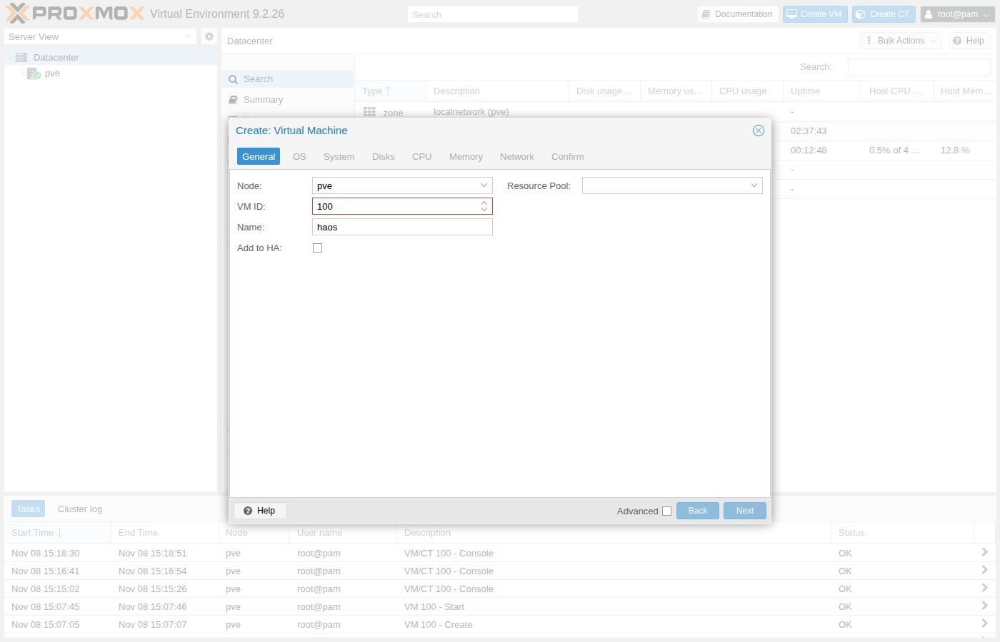
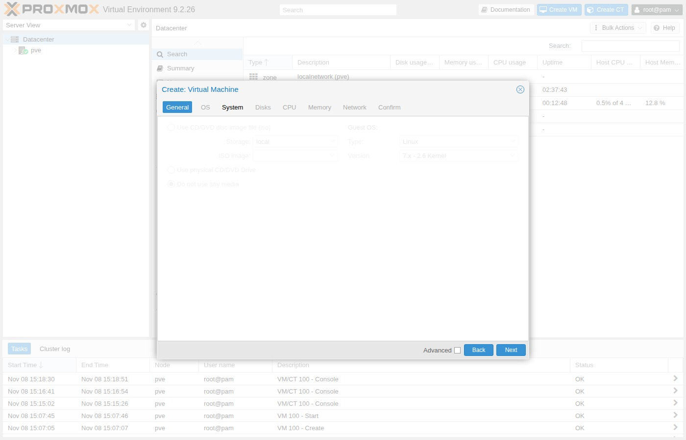
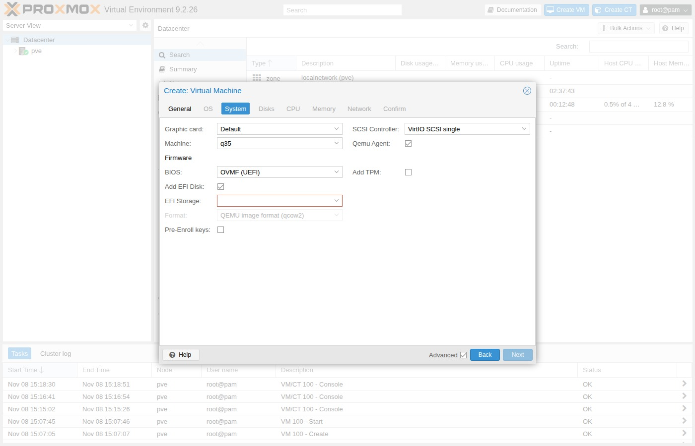
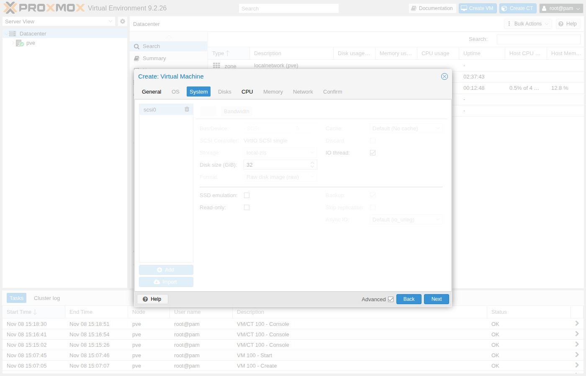
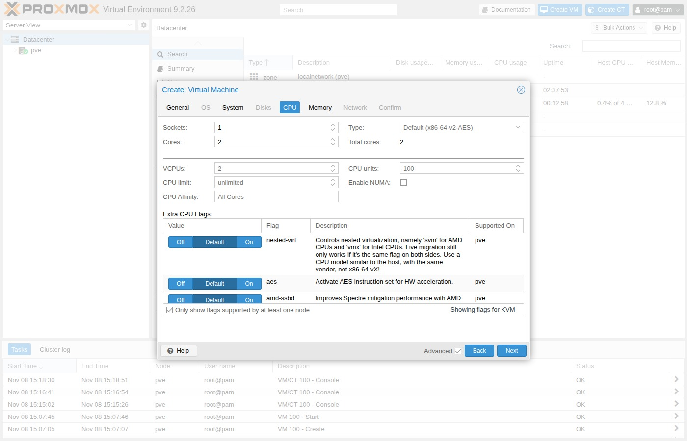
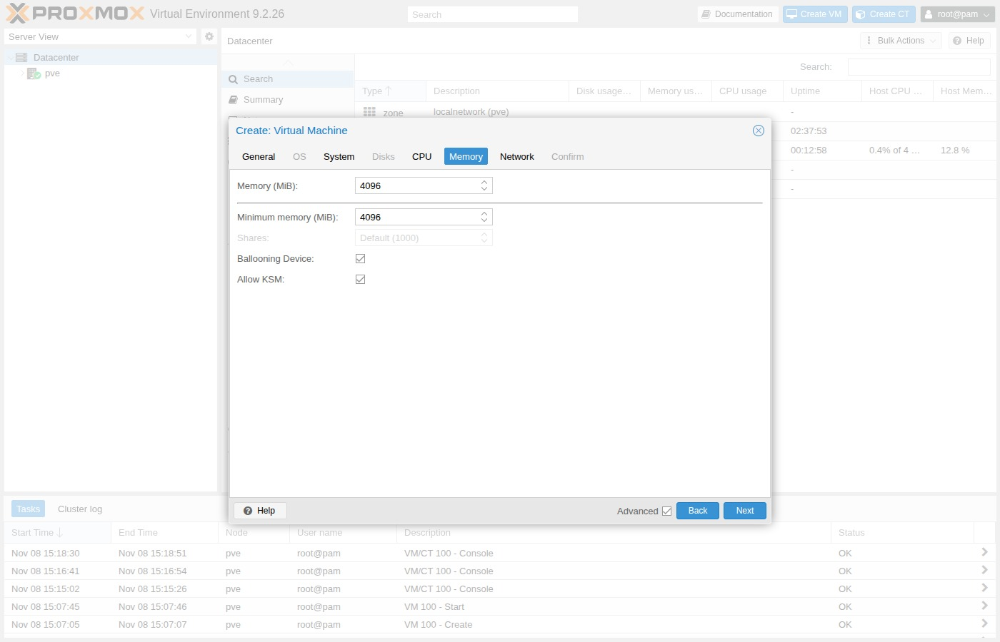
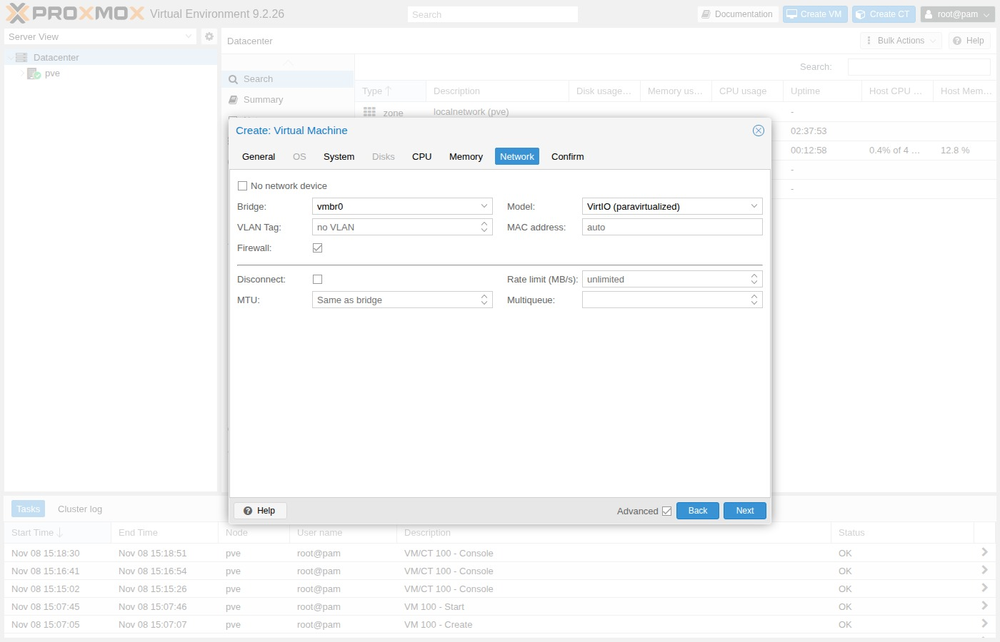
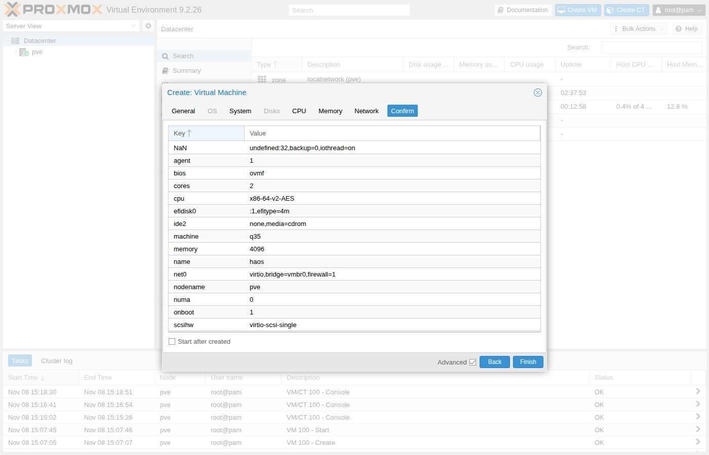

# Create VM

In the Proxmox web UI, open **Create VM**. Leave **Start after created** off —
you import the disk next.

## General

Tick **Advanced** at the bottom of the wizard once. It keeps the extra fields
(Start at boot, CPU flags, memory ballooning) visible on every tab.

| Field | Value |
| --- | --- |
| Node | your Proxmox node (example `pve`) |
| VM ID | free ID (example `100`; use `pvesh get /cluster/nextid`) |
| Name | `haos` |
| Start at boot | on (shown with **Advanced** ticked) |

## OS

| Field | Value |
| --- | --- |
| ISO image | **Do not use any media** |
| Guest OS type | Linux |
| Version | Leave the default (`7.x - 2.6 Kernel` on current Proxmox VE) |

## System

=== "Two disks: ZFS mirror"

    Put the EFI disk on `local-zfs`.

=== "One disk: ext4"

    Put the EFI disk on `local-lvm`.

| Field | Value |
| --- | --- |
| Graphic card | Default |
| Machine | **q35** |
| BIOS | **OVMF (UEFI)** |
| Add EFI Disk | on |
| EFI Storage | `local-zfs` or `local-lvm` (match your tab) |
| Pre-Enroll keys | **off** (Secure Boot breaks HAOS) |
| SCSI Controller | **VirtIO SCSI single** |
| QEMU Guest Agent | **on** |

!!! danger "Pre-Enroll keys"
    Leave **Pre-Enroll keys** unticked. With Secure Boot on, HAOS fails to boot
    (UEFI “Access Denied” or a boot loop).

## Disks

Delete the wizard’s default hard disk. You attach the HAOS image in the next
page — do not keep an empty unused disk.

## CPU

| Field | Value |
| --- | --- |
| Sockets | 1 |
| Cores | 2 |
| Type | `host` |

## Memory

| Field | Value |
| --- | --- |
| Memory | **4096** MiB (official minimum is 2048) |

## Network

| Field | Value |
| --- | --- |
| Bridge | `vmbr0` |
| Model | VirtIO (`virtio`) |
| Firewall | off (lab default) |

## Confirm

Review the summary. Keep **Start after created** off, then **Finish**.

## Next

[Import disk](import-disk.md){ .md-button }
