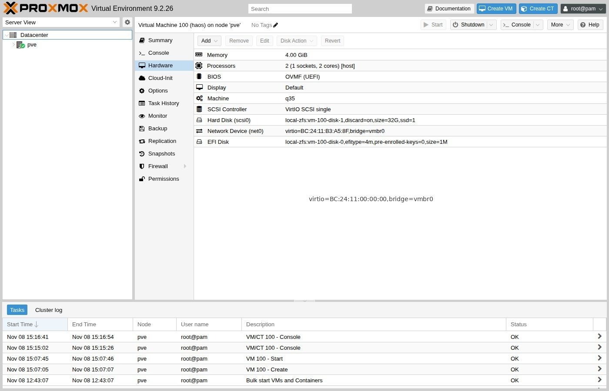

# Import disk

On the **Proxmox host** shell. Replace `100` with your VMID and set `STORAGE`
from [What you need](prerequisites.md).

## Import and attach

=== "Two disks: ZFS mirror"

    <div class="run" markdown>

    ```bash
    STORAGE=local-zfs
    qm set 100 \
      --scsi0 ${STORAGE}:0,import-from=/var/lib/vz/template/haos_ova-18.5.qcow2,discard=on,ssd=1 \
      --boot order=scsi0
    ```

    ```text {.no-copy}
    update VM 100: -boot order=scsi0 -scsi0 local-zfs:0,import-from=…
    transferred … of 32.0 GiB (100.00%)
    scsi0: successfully created disk 'local-zfs:vm-100-disk-1,discard=on,size=32G,ssd=1'
    ```

    </div>

=== "One disk: ext4"

    <div class="run" markdown>

    ```bash
    STORAGE=local-lvm
    qm set 100 \
      --scsi0 ${STORAGE}:0,import-from=/var/lib/vz/template/haos_ova-18.5.qcow2,discard=on,ssd=1 \
      --boot order=scsi0
    ```

    ```text {.no-copy}
    update VM 100: -boot order=scsi0 -scsi0 local-lvm:0,import-from=…
    transferred … of 32.0 GiB (100.00%)
    scsi0: successfully created disk 'local-lvm:vm-100-disk-1,discard=on,size=32G,ssd=1'
    ```

    </div>

## Prove the config

<div class="run" markdown>

```bash
qm config 100
```

```text {.no-copy}
agent: enabled=1
bios: ovmf
boot: order=scsi0
cores: 2
cpu: host
efidisk0: local-zfs:vm-100-disk-0,efitype=4m,pre-enrolled-keys=0,size=1M
machine: q35
memory: 4096
name: haos
net0: virtio=…,bridge=vmbr0
onboot: 1
scsi0: local-zfs:vm-100-disk-1,discard=on,size=32G,ssd=1
scsihw: virtio-scsi-single
```

</div>

Confirm `bios: ovmf`, `pre-enrolled-keys=0`, `boot: order=scsi0`, and
`scsi0` on your storage.



!!! tip "Grow later"
    The image is 32 GB. You can enlarge it later under **Hardware → Disk →
    Resize Disk**; HAOS expands its data partition on the next boot.

## Clean up the template files

After a successful import:

<div class="run" markdown>

```bash
rm -f /var/lib/vz/template/haos_ova-18.5.qcow2 \
      /var/lib/vz/template/haos_ova-18.5.qcow2.xz
```

```text {.no-copy}
```

</div>

## Next

[Start and prove](prove-ui.md){ .md-button }
