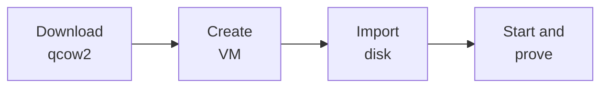

# Overview

Install **Home Assistant OS** as a VM on a Proxmox VE host that already has a
working web UI, then open the onboarding screen on your LAN.

| Step | Page | You end with |
| --- | --- | --- |
| 1 | [Download image](download.md) | Verified `haos_ova-18.5.qcow2` on the host |
| 2 | [Create VM](create-vm.md) | Empty UEFI VM (`haos`) with no disk image yet |
| 3 | [Import disk](import-disk.md) | qcow2 attached as `scsi0`, boot order set |
| 4 | [Start and prove](prove-ui.md) | Onboarding at `http://homeassistant.local:8123` |

!!! info "Out of scope"
    Proxmox host install, apt repos, clustering, Ceph, Supervised or Container
    installs, add-ons, HACS, and onboarding past the welcome screen. Host prep
    lives in the [Proxmox VE walkthrough](https://proxmox-ve-walkthrough.johna.kiwi/).

[What you need](prerequisites.md){ .md-button }
