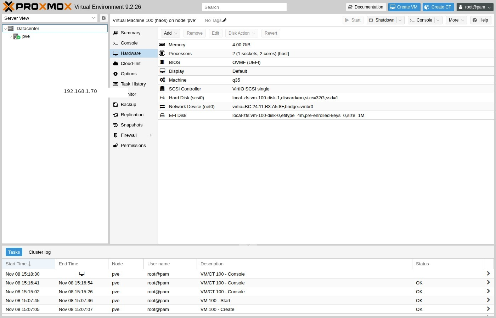
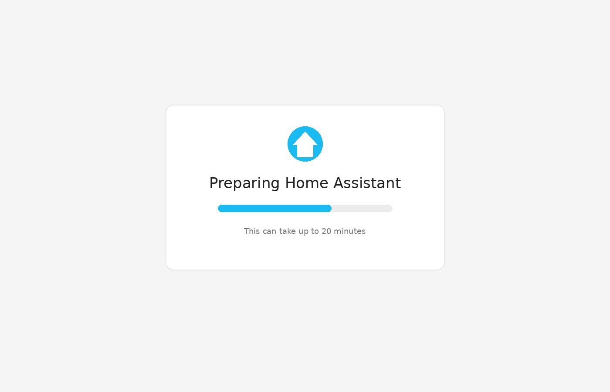
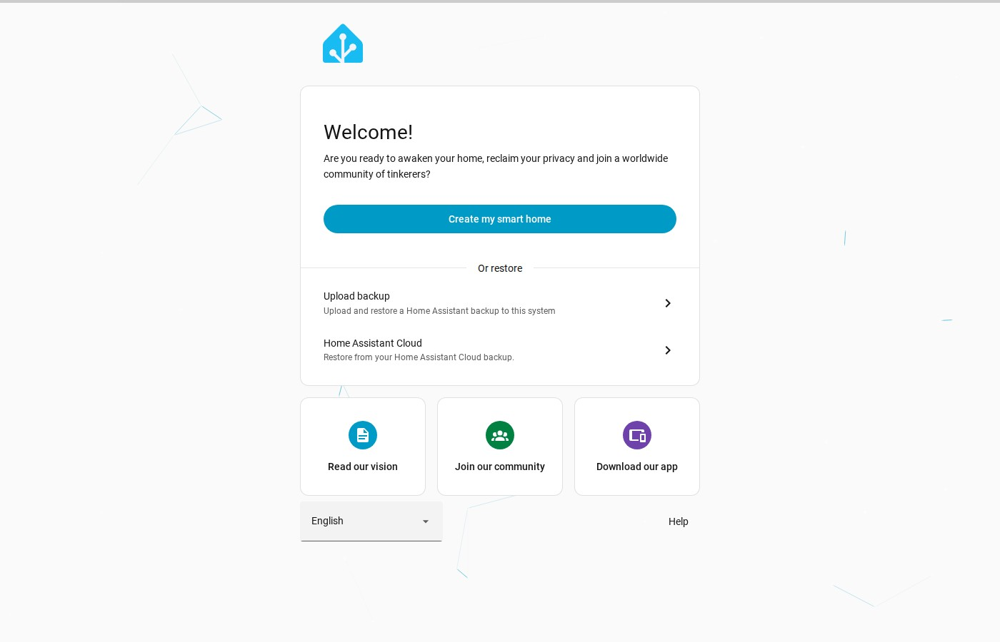

# Start and prove

## 1. Start the VM

On the host:

<div class="run" markdown>

```bash
qm start 100
qm status 100
```

```text {.no-copy}
status: running
```

</div>

Open **Console** (noVNC). Wait for the HAOS banner. Note the IPv4 address if
shown.



## 2. Guest agent and IP

When the agent is up:

<div class="run" markdown>

```bash
qm agent 100 network-get-interfaces
```

```text {.no-copy}
[
   {
      "name" : "enp6s18",
      "ip-addresses" : [
         {
            "ip-address" : "192.168.1.70",
            "ip-address-type" : "ipv4",
            "prefix" : 24
         }
      ]
   }
]
```

</div>

Your address will differ. Prefer mDNS (`homeassistant.local`) when it works on
your LAN.

!!! tip "DHCP reservation"
    HAOS uses DHCP by default. Reserve the MAC on your router so the IP stays
    stable. Static addressing inside HAOS is out of scope here.

## 3. Reach the UI

From the **workstation**. First boot can show a preparing screen for up to
about 20 minutes.



Then prove HTTP. Port `8123` may redirect to port `80`:

<div class="run" markdown>

```bash
curl -sS -o /dev/null -w "%{http_code} %{redirect_url}\n" \
  http://192.168.1.70:8123/
```

```text {.no-copy}
302 http://192.168.1.70/
```

</div>

Open `http://homeassistant.local:8123/` or `http://<guest-ip>:8123/` and wait
for the welcome screen.



Stop here. Account creation and integrations belong in consuming labs — see
[Onboarding](https://www.home-assistant.io/getting-started/onboarding/).

!!! tip "USB Zigbee / Z-Wave"
    **Hardware → Add → USB Device**, then pick the dongle by vendor/device ID
    (or bus/port). Restart the VM after attaching. Details:
    [USB devices in VMs](https://pve.proxmox.com/wiki/USB_Devices_in_Virtual_Machines).

!!! note "Consuming labs"
    Keep `HA_HOST` and credentials in that project’s env file. Never commit
    passwords or API tokens.

## Done

You have HAOS running on Proxmox with the onboarding UI reachable. Something
wrong? See [Troubleshooting](troubleshooting.md).
